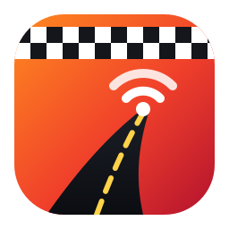

<p align="center">
  
</p>

<h1 align="center">Race-O-Rama Online</h1>

<p align="center">
  Online-Mehrspieler für <b>Cars Race-O-Rama</b> (Nintendo DS, Europa) – Rennen mit bis zu 4 Spielern über das Internet.<br>
  Eigener Netcode · Launcher mit einem Klick · melonDS inklusive
</p>

<p align="center">
  <a href="README.md">🇬🇧 English version</a>
</p>

> **Status: Beta.** Alles hier Beschriebene funktioniert und wurde mit 4 Spielern aus verschiedenen Netzwerken
> getestet – mit kleinen Ecken und Kanten ist aber zu rechnen. Fehlermeldungen sind sehr willkommen
> (siehe [Mithelfen](#mithelfen)).

---

## Was ist das?

Cars Race-O-Rama für den Nintendo DS hat nur **lokalen Drahtlos-Mehrspieler**: Die Konsolen funken direkt
miteinander über das eigene Funkprotokoll des DS. Emulatoren können das zwischen Instanzen auf einem PC
nachbilden, über das Internet bricht es aber zusammen – das Spiel erwartet wenige Millisekunden Verzögerung und
trennt die Verbindung oder läuft mit 3 FPS.

Race-O-Rama Online ersetzt die Funkschicht des Spiels durch **eigenen Netcode**, der über einen kleinen Server
läuft – ähnlich wie Wiimmfi oder Super Mario Odyssey Online:

* **Virtuelle Funkschicht** – die Aufrufe des Spiels an Nintendos WLAN-Bibliothek (Raum öffnen, suchen, beitreten,
  Daten senden) werden auf unseren eigenen Code umgeleitet. Das Spiel glaubt weiterhin, mit DS-Konsolen in der
  Nähe zu sprechen.
* **Kleiner Netzwerk-Stack auf DS-Seite** – der Patch bringt einen eigenen kleinen UDP/IP-Stack mit und spricht
  über das WLAN des Emulators mit dem Server.
* **Server** – verwaltet Räume (ein Host + bis zu 3 Mitspieler), leitet Lobby-Nachrichten *zuverlässig* weiter
  (Bestätigungen, Wiederholungen, Umsortieren) und Renndaten mit geringer Verzögerung.
* **Lockstep fürs Internet** – im Rennen zeigt jede Konsole alle Autos mit derselben kleinen Verzögerung, die sich
  automatisch an den Ping anpasst. Verlorene Pakete werden gezielt nachgeliefert, sodass Rennen auch bei
  schlechter Verbindung weiterlaufen. Der Rennstart ist für alle synchron.
* **Komfort-Patches** – das Spiel springt direkt zu *Host* oder *Beitreten*, und der online unbenutzte
  *Single Card Play*-Knopf (Download Play) ist ausgeblendet.

Der **Launcher** verbindet alles: Er patcht deine eigene Kopie des Spiels, richtet melonDS ein, findet Server und
startet das Spiel mit einem Klick.

## Funktionen

* 🏁 **Online-Rennen mit bis zu 4 Spielern** – inklusive Grand Prix, Kollisionen und Überholen
* 🖱️ **Spielen mit einem Klick** – *Raum hosten* oder *Raum beitreten*: Das Spiel überspringt Titelbild,
  Profilauswahl und Menüs und landet direkt in der Lobby
* 🔍 **Automatische Server-Suche** – Server deiner Freunde im Tailscale-Netz erscheinen von selbst
* 🖥️ **Hosten mit einem Klick** – startet den Server in einem eigenen Fenster und zeigt deine Adresse
* 🔓 **Online alles freigeschaltet** – eigenes Online-Profil (Profilplatz 3) mit allen Autos und Strecken;
  deine Story-Profile bleiben unberührt
* 🎮 **Tastatur- und Controller-Belegung** – mit den Aktionen im Spiel (Fahren, Bremse, Fähigkeit, Springen …)
* 🖼️ **Bild-Einstellungen** – Anordnung der Bildschirme, OpenGL-Hochskalierung bis 8×, Vollbild
* 🌐 **Deutsch & Englisch**
* 📦 **Alles dabei** – melonDS und alle Abhängigkeiten sind enthalten; du bringst nur dein eigenes Spiel mit

## Voraussetzungen

* Windows 10 oder 11 (64 Bit)
* Deine eigene, legal erworbene Kopie von **Cars Race-O-Rama (Europa)** als `.nds`-Datei (Spielcode `B6OP`)
* Zum Spielen mit Freunden: [Tailscale](https://tailscale.com) (kostenlos) – siehe [Netzwerk](#netzwerk-vorerst-tailscale)

## Installation

1. **`RORM-Online-…-windows.zip`** aus dem [neuesten Release](https://github.com/BlwLeon/Cars-ROR-Online/releases/latest)
   herunterladen ([alle Releases](https://github.com/BlwLeon/Cars-ROR-Online/releases)) und irgendwo entpacken
   (z. B. `Dokumente\RORM-Online`).
2. **`RORM Online.exe`** starten.
   * Windows zeigt eventuell *„Der Computer wurde durch Windows geschützt“*, weil das Programm neu und noch nicht
     signiert ist. *Weitere Informationen → Trotzdem ausführen* klicken. Das Programm ist Open Source und wird
     automatisch aus diesem Repository gebaut.
3. Sprache wählen, dann **deine eigene Spieldatei** (`.nds`) auswählen. Der Launcher prüft sie und erstellt eine
   Online-Kopie in seinem Ordner `user`. Deine Original-Datei wird nicht verändert.
4. Ein kurzes **Erste Schritte**-Fenster führt durch den Rest: Online-Namen wählen (*Profil*), Steuerung
   einrichten (*Einstellungen*), mit Freunden verbinden (*Server*) und losfahren (*Spielen*). Es lässt sich
   jederzeit über *Erste Schritte* unten links wieder öffnen.

## Spielen

**Alle** installieren Tailscale und sind im selben Tailnet (Freunde einladen oder den eigenen PC mit ihnen teilen).

**Host (ein Spieler):**
1. Reiter *Server* → **Server starten**. Ein Server-Fenster öffnet sich. Fragt Windows nach der Firewall:
   Zugriff für *private und öffentliche* Netzwerke erlauben.
2. Reiter *Spielen* → **Raum hosten**. Das Spiel springt direkt zum Host-Bildschirm – Raum öffnen.

**Alle anderen:**
1. Reiter *Server* → **Suchen** → Server des Hosts auswählen (der Punkt unten links wird grün).
2. Reiter *Spielen* → **Raum beitreten** und den Raum aus der Liste wählen.

Dann Strecke wählen und los! Der Host kann auch auf demselben PC spielen, auf dem der Server läuft.

## Netzwerk (vorerst Tailscale)

Das Spiel selbst braucht nur **ausgehende** Verbindungen zum Server – Spieler müssen nie Ports freigeben.
Der **Server** muss aber für alle erreichbar sein. Aktuell heißt das:

* **Tailscale (empfohlen, vom Launcher genutzt)** – ein kostenloses VPN, das eure PCs in ein privates Netz
  bringt. Keine Router-Einstellungen; der Launcher findet Server im Tailnet automatisch. Ideal für Freundeskreise.
* **Andere VPNs / LAN (Radmin VPN, ZeroTier, Hamachi, gleiches Heimnetz)** – der Launcher sucht zusätzlich per
  Broadcast in allen lokalen Netzwerkadaptern. Taucht ein Server trotzdem nicht auf, die VPN-IP des Hosts unter
  *Server* → *Adresse eingeben* eintragen. Windows stuft Radmin-Adapter oft als *öffentliches* Netz ein – der Host
  muss den Server in der Firewall also auch für öffentliche Netze erlauben.
* **Öffentliche IP / Portfreigabe** – UDP-Port `27015` zum Server-PC weiterleiten und anderen die öffentliche
  Adresse geben (Reiter *Server* → *Adresse eingeben*). Funktioniert, braucht aber Zugriff auf den Router.

Was es **noch nicht** gibt, ist ein öffentlicher Server, dem jeder ohne Tailscale beitreten kann. Die Technik ist
bereit (der Server läuft auf jedem kleinen Linux-Rechner – es ist eine einzige Python-Datei); es ist vor allem
eine Frage des Hostings.

**Du hast eine Idee oder willst helfen?** Wenn du einen besseren Weg kennst, Server ohne VPN erreichbar zu machen,
oder freiwillig einen **Community-Server** hosten würdest, öffne bitte ein [Issue](../../issues). Das ist gerade
die hilfreichste Unterstützung.

### Eigenen Server betreiben

Der Server ist eine einzelne Python-3-Datei ohne Abhängigkeiten und läuft unter Windows, Linux und macOS:

```
python server/server.py            # UDP-Port 27015
python server/server.py 27016 --name "Mein Server"
```

Jede Sitzung schreibt `server_log.txt` neben den Server. Mit `--lag/--jitter/--loss` lässt sich eine schlechte
Verbindung zum Testen simulieren.

## Aus dem Quellcode bauen

| Teil | Ort | Wie |
|---|---|---|
| DS-Patch (`net.elf`) | `patch/` | `./patch/build.sh` (braucht `clang` + `ld.lld`) |
| Launcher + Server (Windows) | `launcher/` | `launcher\build_launcher.bat` (braucht Python 3.11+) → `launcher\release\` |
| Launcher aus dem Quellcode | `launcher/` | `launcher\run_dev.bat` |

Das mitgelieferte `patch/net.elf` lässt sich bytegleich aus `patch/src` bauen. GitHub Actions baut bei jedem Push
alles automatisch. Technische Notizen zu den Interna des Spiels und zum Protokoll stehen in
[`docs/RE_NOTES.md`](docs/RE_NOTES.md).

## Bekannte Einschränkungen

* Nur die **europäische** Version (`B6OP`) wird unterstützt.
* Der Launcher läuft nur unter Windows (der Server überall).
* Andere Autos erscheinen mit einer kleinen Verzögerung, die mit dem Ping wächst (meist 3–6 Frames) – der übliche
  Kompromiss beim Online-Spiel auf Hardware, die für lokales Funken gebaut wurde.
* Echte DS-Hardware ist nicht getestet.

## Mithelfen

* 🐞 **Fehler:** Ein [Issue](../../issues) öffnen und beschreiben, was passiert ist. Savestates (`Shift+F1` in
  melonDS) und die Dateien `user\launcher_log.txt` / `server\server_log.txt` helfen sehr – aber bitte keine ROMs
  hochladen.
* 🌍 **Community-Server / Netzwerk-Ideen:** siehe [Netzwerk](#netzwerk-vorerst-tailscale).
* 🌐 **Übersetzungen:** Alle Texte des Launchers stehen in `launcher/ui/i18n.js`.

## Danksagung

* [melonDS](https://melonds.kuribo64.net) – der mitgelieferte Nintendo-DS-Emulator
  (GPL-3.0, Quellcode: [github.com/melonDS-emu/melonDS](https://github.com/melonDS-emu/melonDS)). Unveränderter
  offizieller Build.
* [pywebview](https://pywebview.flowrl.com), [PySDL2](https://github.com/py-sdl/py-sdl2), [PyInstaller](https://pyinstaller.org)

## Lizenz

Race-O-Rama Online ist freie Software unter der **GNU General Public License v3.0** – siehe [`LICENSE`](LICENSE).

## Rechtlicher Hinweis

**Dieses Repository und seine Downloads enthalten und verbreiten keine urheberrechtlich geschützten Spieldaten.**
Keine ROMs, keine Spieldateien, keine Spielstände, keine BIOS- oder Firmware-Dateien und keine Grafiken, Logos,
Figuren, Musik oder anderen Inhalte der Rechteinhaber. Das Logo und alle Grafiken des Launchers sind eigene Werke.

Alles, was hier verbreitet wird, ist eigener Code: ein Patch, ein Launcher und ein Server. Zum Spielen brauchst du
deine eigene, legal erworbene Kopie des Spiels. Der Launcher wendet den Patch lokal auf deinem Computer auf deine
eigene Kopie an; das Ergebnis wird nie hochgeladen oder weitergegeben.

Race-O-Rama Online ist ein nicht-kommerzielles Fanprojekt und steht in **keiner Verbindung zu** Disney, Pixar,
THQ, Nintendo oder anderen Rechteinhabern und wird von ihnen weder unterstützt noch gesponsert oder genehmigt.
*Cars* und *Cars Race-O-Rama* sind Marken ihrer jeweiligen Inhaber; *Nintendo DS* ist eine Marke von Nintendo.
Alle Marken werden nur zur Kennzeichnung verwendet. Falls du Rechteinhaber bist und Bedenken hast, öffne bitte
ein Issue – wir reagieren umgehend.
