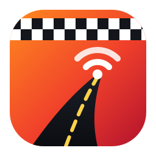

<p align="center">
  
</p>

<h1 align="center">Race-O-Rama Online</h1>

<p align="center">
  Online multiplayer for <b>Cars Race-O-Rama</b> (Nintendo DS, Europe) – race with up to 4 players over the internet.<br>
  Custom netcode · one-click launcher · bundled melonDS
</p>

<p align="center">
  <a href="README.de.md">🇩🇪 Deutsche Version</a>
</p>

> **Status: beta 2** ([changelog](../../releases)). Everything described here works and has been tested with 4 players on different networks,
> but expect rough edges. Bug reports are very welcome (see [Contributing](#contributing--help-wanted)).

---

## What is this?

Cars Race-O-Rama for the Nintendo DS only has **local wireless** multiplayer: the consoles talk to each other
directly over the DS's own radio protocol. Emulators can imitate that between instances on one PC, but over the
internet it falls apart – the game expects a few milliseconds of latency and disconnects or crawls at 3 FPS.

Race-O-Rama Online replaces the game's wireless layer with **custom netcode** that runs through a small server,
similar in spirit to Wiimmfi or Super Mario Odyssey Online:

* **Virtual wireless layer** – the game's calls into Nintendo's wireless library (host a room, scan, join, send
  data) are redirected to our own code. The game still believes it is talking to other DS consoles nearby.
* **Tiny network stack on the DS side** – our patch brings its own small UDP/IP stack and talks to the server
  through the emulator's Wi-Fi.
* **Server** – keeps rooms (one host + up to 3 players), relays lobby messages *reliably* (acknowledgements,
  resends, out-of-order buffering) and race data with low latency.
* **Lockstep built for the internet** – during a race every console shows all cars with the same small delay,
  which adapts automatically to the ping. Lost packets are re-sent where needed, so races keep running even on bad
  connections. The race start is frame-exact for everyone: all consoles share the game's sync clock, and if one
  emulator stutters (shader compiling, loading), the others wait for it.
* **Comfort patches** – the game can jump straight to *Host* or *Join*, and the unused *Single Card Play*
  (Download Play) button is hidden.

The **launcher** puts it all together: it patches your own copy of the game, sets up melonDS, finds servers and
starts the game with one click.

## Features

* 🏁 **Online races for up to 4 players** – including full Grand Prix, collisions and overtaking
* 🖱️ **One-click play** – *Host a room* or *Join a room*: the game skips the title screen, profile selection and
  menus and lands directly in the lobby
* 🔍 **Automatic server search** – servers of your friends appear by themselves: via Tailscale, in your LAN and
  in VPNs like Radmin VPN or ZeroTier
* 🖥️ **Host with one click** – starts the server in its own window and shows your address
* 🔓 **Everything unlocked online** – a separate online profile (profile slot 3) with all cars and tracks;
  your own story profiles stay untouched
* 📊 **Profile & stats** – races, wins, average place and your most frequent rivals; click a race to see every
  driver with finish time, best lap and lap times
* 🎮 **Keyboard & controller mapping** – with the in-game action names (Accelerate, Brake, Ability, Jump …)
* 🖼️ **Display settings** – screen layout, OpenGL upscaling up to 8×, fullscreen
* 🌐 **English & German**
* 📦 **Self-contained** – melonDS and all dependencies are included; you only bring your own game

## Requirements

* Windows 10 or 11 (64-bit)
* Your own, legally obtained copy of **Cars Race-O-Rama (Europe)** as a `.nds` file (game code `B6OP`)
* To play with friends: [Tailscale](https://tailscale.com) (free, recommended) or another VPN such as Radmin VPN –
  see [Networking](#networking-tailscale--vpns)

## Installation

1. Download **`RORM-Online-…-windows.zip`** from the [latest release](https://github.com/BlwLeon/Cars-ROR-Online/releases/latest)
   ([all releases](https://github.com/BlwLeon/Cars-ROR-Online/releases)) and unzip it anywhere
   (e.g. `Documents\RORM-Online`).
2. Start **`RORM Online.exe`**.
   * Windows may show *"Windows protected your PC"* because the program is new and not code-signed yet.
     Click *More info → Run anyway*. The program is open source and built automatically from this repository.
3. Choose your language, then **select your own game file** (`.nds`).
   The launcher checks it and creates an online copy in its `user` folder. Your original file is not modified.
4. A short **Getting started** window walks you through the rest: choose your online name (*Profile*), set up
   your controls (*Settings*), connect with your friends (*Server*) and race (*Play*). You can open it again any
   time via *Getting started* at the bottom left.

## Playing

**Everyone** installs Tailscale and joins the same tailnet (invite your friends or share your PC with them) – or
you all join the same Radmin VPN / ZeroTier network. **Everyone in a room needs the same version** of the launcher.

**Host (one player):**
1. *Server* tab → **Start server**. A server window opens. If Windows asks about the firewall, allow access for
   *private and public* networks.
2. *Play* tab → **Host a room**. The game goes straight to the host screen – open the room.

**Everyone else:**
1. *Server* tab → **Search** → select the host's server (the dot at the bottom left turns green).
2. *Play* tab → **Join a room** and pick the room from the list.

Then choose the track and go! The host can also play on the same PC as the server.

## Networking (Tailscale & VPNs)

The game itself only needs **outgoing** connections to the server – players never need open ports.
The **server**, however, must be reachable for everyone. Right now that means one of:

* **Tailscale (recommended, used by the launcher)** – a free VPN that puts your PCs in one private network.
  No router configuration; the launcher finds servers in your tailnet automatically. Great for groups of friends.
* **Other VPNs / LAN (Radmin VPN, ZeroTier, Hamachi, same home network)** – the launcher also searches every
  local network adapter by broadcast. If a server still does not show up, enter the host's VPN IP under
  *Server* → *Enter address*. On Windows, Radmin adapters are often classified as a *public* network, so the
  host must allow the server through the firewall for public networks too.
* **Public IP / port forwarding** – forward UDP port `27015` to the server PC and give others your public address
  (*Server* tab → *Enter address*). Works, but needs router access.

What we do **not** have yet is a public server that anyone can join without a VPN. The technology is ready
(the server runs on any small Linux machine – it is a single Python file), it is mainly a question of hosting.

**Have an idea or want to help?** If you know a better way to make servers reachable without a VPN, or you would
volunteer to host a **community server**, please open an [issue](../../issues). That is the most helpful
contribution right now.

### Running a dedicated server

The server is a single Python 3 file without dependencies and runs on Windows, Linux and macOS:

```
python server/server.py            # UDP port 27015
python server/server.py 27016 --name "My Server"
```

Every session writes `server_log.txt` (log) next to the server. Option `--lag/--jitter/--loss` simulates a bad
connection for testing. The server also remembers finished races (players, places, times) until it is restarted;
the launchers fetch them for the profile stats.

## Building from source

| Part | Location | How |
|---|---|---|
| DS patch (`net.elf`) | `patch/` | `./patch/build.sh` (needs `clang` + `ld.lld`) |
| Launcher + server (Windows) | `launcher/` | `launcher\build_launcher.bat` (needs Python 3.11+) → `launcher\release\` |
| Launcher from source | `launcher/` | `launcher\run_dev.bat` |

The prebuilt `patch/net.elf` is built reproducibly from `patch/src`. GitHub Actions builds everything on every push.
Technical notes (German) about the game internals and the protocol are in [`docs/RE_NOTES.md`](docs/RE_NOTES.md).

## Known limitations

* Only the **European** version (`B6OP`) is supported.
* The launcher is Windows-only (the server runs everywhere).
* Other cars are shown with a small delay that grows with the ping (typically 3–6 frames) – the usual trade-off
  of online play on hardware that was built for local wireless.
* Real DS hardware has not been tested.
* Track names are not shown in the race history yet (only the track number) – the list is being collected.
* Races only appear in your profile while the server that hosted them is still running.

## Contributing / help wanted

* 🐞 **Bugs:** open an [issue](../../issues) and describe what happened. Save states (`Shift+F1` in melonDS) and
  the files `user\launcher_log.txt`, `user\crash_log.txt` (launcher crashes) and `server\server_log.txt` help a lot – but please don't upload ROMs.
* 🌍 **Community server / networking ideas:** see [Networking](#networking-tailscale--vpns).
* 🌐 **Translations:** all launcher texts are in `launcher/ui/i18n.js`.

## Credits

* [melonDS](https://melonds.kuribo64.net) – the Nintendo DS emulator bundled with the launcher
  (GPL-3.0, source: [github.com/melonDS-emu/melonDS](https://github.com/melonDS-emu/melonDS)). Unmodified official
  build.
* [pywebview](https://pywebview.flowrl.com), [PySDL2](https://github.com/py-sdl/py-sdl2), [PyInstaller](https://pyinstaller.org)

## License

Race-O-Rama Online is free software under the **GNU General Public License v3.0** – see [`LICENSE`](LICENSE).

## Legal notice

**This repository and its releases do not contain or distribute any copyrighted game data.** No ROMs, no game
files, no save files, no BIOS or firmware, and no artwork, logos, characters, music or other assets of the
rights holders. The logo and all graphics of the launcher are original work.

Everything distributed here is our own code: a patch, a launcher and a server. To play, you need your own,
legally obtained copy of the game. The launcher applies the patch locally on your computer to your own copy;
the result is never uploaded or shared.

Race-O-Rama Online is a non-commercial fan project. It is **not affiliated with, endorsed, sponsored or approved
by** Disney, Pixar, THQ, Nintendo or any other rights holder. *Cars* and *Cars Race-O-Rama* are trademarks of
their respective owners; *Nintendo DS* is a trademark of Nintendo. All trademarks are used for identification
only. If you are a rights holder and have concerns, please open an issue and we will respond promptly.
